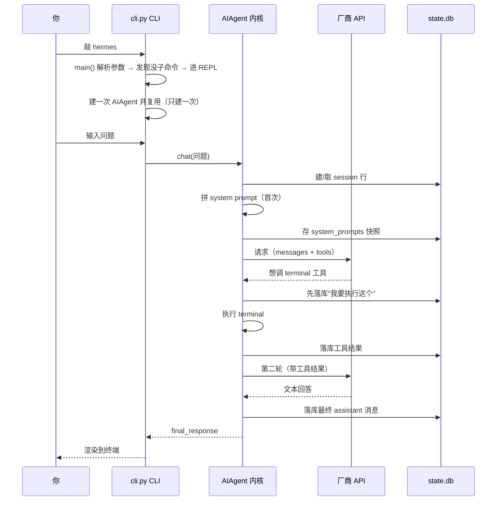
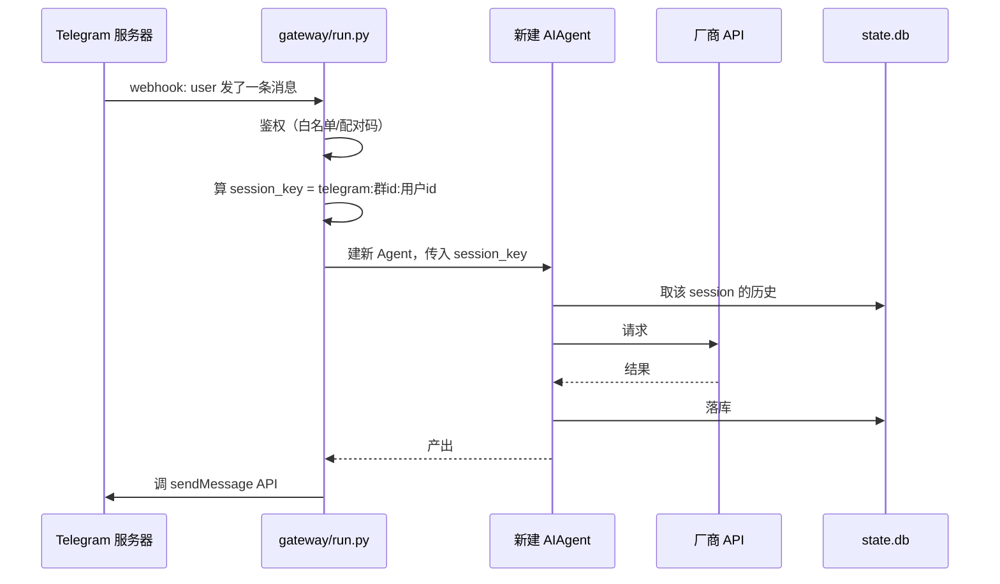
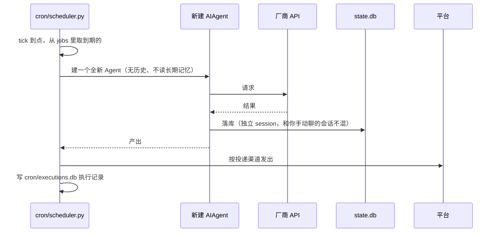
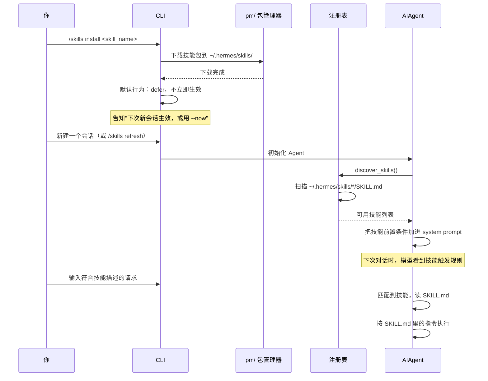
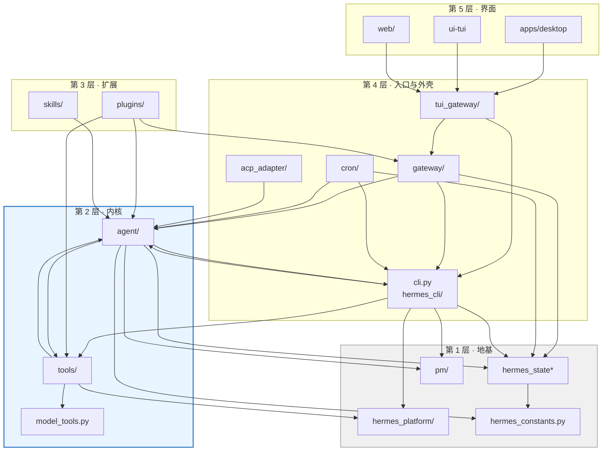
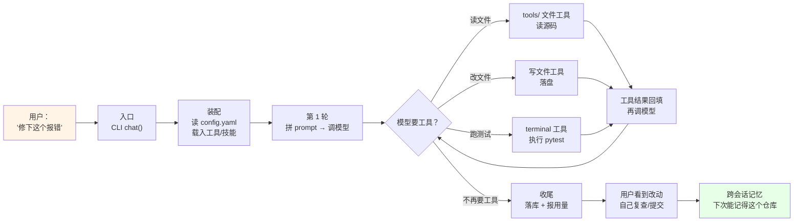
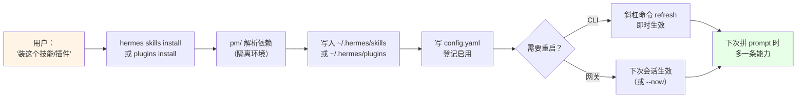
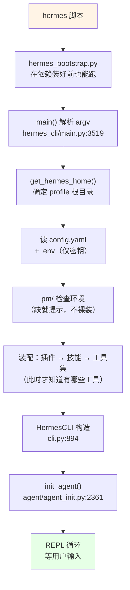
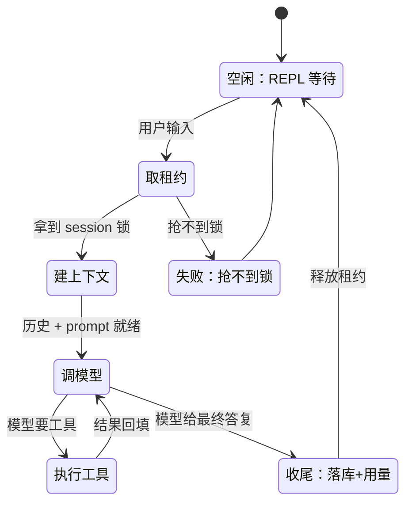
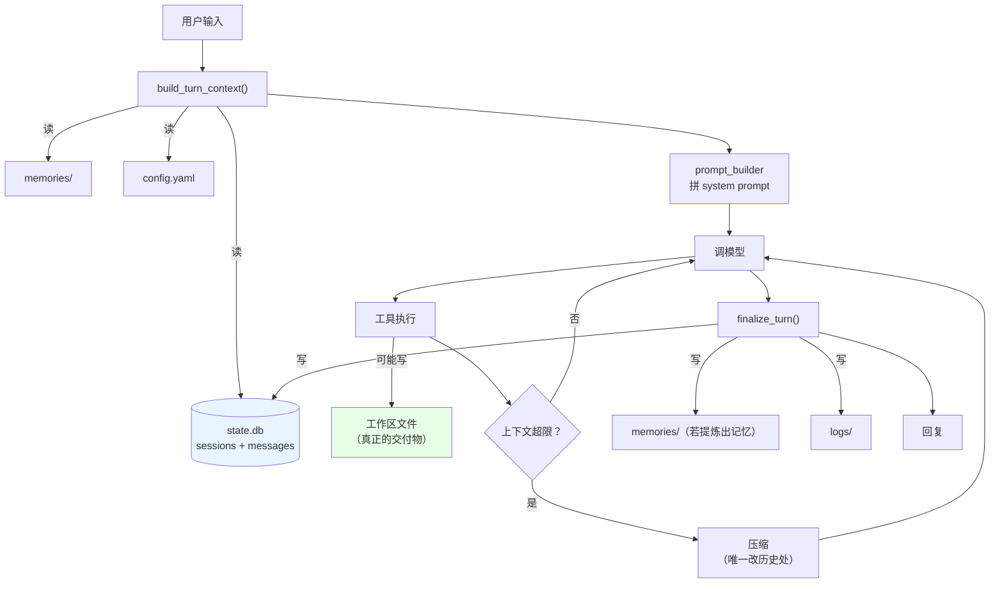

# 01 · 架构总览：先懂产品，再懂系统

> **这篇的定位**：全套学习指南的教学主线，覆盖 L2 + L3 掌握深度。
> 用四层渐进结构（产品 → 原理 → 系统 → 工程）回答五个问题：
>
> 1. Hermes 是什么产品，为谁解决什么问题？
> 2. Agent 靠什么原理转起来？
> 3. 这么多代码如何分工协作？
> 4. 怎么接入、怎么排障、怎么扩展？
> 5. 哪些设计不能动、动了会怎样？
>
> **无需会读这个仓库的代码**即可读第一、二部分。
> 如果你只有 30 分钟，读 **§1 + §2** 两段就够；
> 如果要快速定位代码，跳到 **§3.0 + §4.4 症状索引**。
>
> **本篇是方法论 [`.copilotcode/skills/codebase-tutor/SKILL.md`](../.copilotcode/skills/codebase-tutor/SKILL.md) 在 Hermes 上的执行结果**。

---

# 第一部分 · 产品视角：它是什么，为谁解决什么问题

> **读完这一部分你能**：
> - 一句话说出 Hermes 与网页 AI 聊天框的差别；
> - 看着四个真实场景画出「用户动作 → 磁盘/API 落点」的数据流；
> - 知道自己目前的问题属于「六种形态的哪一种」。

## 1.1 产品三问（D1）

### 一句话定义

**Hermes 是一个"住在你电脑（或服务器）里的 AI 助手"**：它能读写你的文件、跑你的命令、开你的浏览器，
记得你上次让它做过什么，还能在你不在的时候按点自己干活。

和网页版 AI 聊天框的关键差别不在"更聪明"，而在**它有手有脚、有记忆、能自己排班**。

### 给谁用、核心场景

| 用户角色 | 核心痛点 | Hermes 解法 |
|---|---|---|
| **本地开发者** | 每天写代码时要在终端、编辑器、浏览器、文档间切换，AI 不直接看到我的项目文件 | 它在本机跑，直接操作你的文件和终端，无需来回粘贴 |
| **团队协作** | 同事问的重复问题（"上次那个脚本在哪"），每次都要翻聊天记录 | 一个实例可同时服务 Telegram / Discord / Slack，各自分开记忆，但共享技能库 |
| **运维值班** | 半夜告警要人起来看日志，第二天早上才知道发生了什么 | 常驻值班：收到告警 → 自己拉日志、判断、发简报 |
| **重复任务** | "每天早上把昨天的数据汇总发群里" —— 要么手动做，要么写脚本 | 定时任务：`/cron add "每天 8 点…"`，它自己执行并投递结果 |

**核心场景速查**：本地开发搭档（最常用）、常驻值班（无人值守）、团队共享知识库（多人多平台）、定时自动化（重复工作流）。

### 使用形态

同一个内核，六种外壳。"外壳"决定你**怎么跟它说话**、"谁负责画界面"。

| 形态 | 你怎么用 | 典型场景 |
|---|---|---|
| **命令行（CLI）** | 终端敲 `hermes`，进入对话 | 本机开发，最完整的能力 |
| **终端界面（TUI）** | `hermes --tui`，有面板、有状态栏 | 想要"界面感"但仍在终端 |
| **桌面应用** | 装 Electron 应用 | 不习惯命令行的人 |
| **消息网关** | 在 Telegram / Discord / Slack 里 @ 它 | 手机上用、团队共享、常驻值班 |
| **看板 / Dashboard** | 浏览器打开 | 观察长任务、看历史 |
| **编辑器（ACP）** | 在 IDE 里调用 | 写代码时不离开编辑器 |

**产品的关键承诺**：这六种形态**不是六个产品**，而是同一个大脑的六张脸。
你在 CLI 里教会它的东西，在 Telegram 里也能用；在桌面应用里跑的定时任务，在 CLI 里能看到执行日志。

### 类比与新手常见误解

**类比：笔记本电脑上的"助理"**  
如果把你的开发环境想象成一个办公桌，Hermes 就是那个坐在旁边的助理：
- 它能翻你桌上的文件（读写项目）；
- 它能替你打电话（调 API）；
- 它能替你记笔记（长期记忆）；
- 它能按你的规定每天早上做例行工作（定时任务）。

**新手常以为**：
- **误解 A**："它是个云服务，我得联网才能用"  
  **其实**：它**本地运行**，只有调模型 API 那一步需要网络；文件读写、命令执行、会话存储全在本机。
- **误解 B**："每次对话都是新的，它不记得上次"  
  **其实**：每个会话（session）的历史都存在本地 `~/.hermes/state.db` 里，下次进来能接着聊；长期记忆插件还能跨会话记住事实。
- **误解 C**："装了插件后要重启才能用"  
  **其实**：CLI 模式下不用重启，用 `/skills refresh` 或 `/plugins reload` 即时生效；网关和 desktop 因为常驻进程，某些插件需要 `/gateway restart` 才更新（插件说明里会标注）。

---

## 1.2 四个用户行为案例：一次看懂"数据怎么流动"（D7）

> **读完这一节你能**：
> - 看着时序图说出「你的操作 → 最终哪几个文件/表变化」；
> - 区分四种行为的数据隔离策略（CLI 复用 Agent、网关按频道分session、cron独立session、插件注册时机）；
> - 知道每个案例想深挖时该去哪一篇专项文档。

产品语言讲完，现在用**四个真实动作**把「你的操作 → 落到磁盘/API 的什么位置」串起来。
每条都标了"想深挖去哪一篇"，这是全书唯一一处**按行为索引**的入口。

### 案例 A：你敲 `hermes` 然后问"帮我看看这个仓库有什么"



**磁盘上留下了什么**：
- `~/.hermes/state.db` 的 `sessions` 表多了一行（记录这次对话的起止时间、模型、token用量）
- `messages` 表多了 4+ 行（你的问题、system prompt、assistant工具调用、工具结果、最终回答）
- `sessions/request_dump_<uuid>.json` 里有这次 API 请求的完整快照（请求体、响应体、耗时）

**和主线相比哪里不同**：
- CLI 模式下 `AIAgent` 只建一次（进入 REPL 时），后续轮次复用同一实例；网关/desktop 每条消息建一次。
- 本地跑不需要鉴权，session key 就是 `cli-<随机uuid>`；网关的 session key 是 `<平台>:<频道id>:<用户id>`。

**想深挖（直接读源码，入口已给）**：
- 入口解析与 REPL 循环 → [`cli.py`](../cli.py:1)（找 `class HermesCLI`）
- `AIAgent.chat()` 内部的循环相位 → [`agent/turn_facade.py`](../agent/turn_facade.py:22) → [`agent/conversation_loop.py`](../agent/conversation_loop.py:1547)
- `state.db` 表结构、写入时机与事务边界 → [`hermes_state.py`](../hermes_state.py:1) + [`hermes_state_sessions.py`](../hermes_state_sessions.py:1)
- 工具注册与执行 → [`tools/registry.py`](../tools/registry.py:1) + [`model_tools.py`](../model_tools.py:872)
- 本仓库的子系统边界与契约 → [`agent/AGENTS.md`](../agent/AGENTS.md:1)、[`tools/AGENTS.md`](../tools/AGENTS.md:1)

### 案例 B：你在 Telegram 里给它发一句话

和案例 A **内核完全一样**，只有前后两段不同：

| 阶段 | CLI（案例 A） | 网关（案例 B） |
|---|---|---|
| 谁触发 | 你敲回车 | 平台 webhook / 长连接推送 |
| 鉴权 | 本机即授权 | 白名单 / 配对码，不通过就丢弃 |
| 会话怎么定 | 进程内变量 | 按「平台 + 频道 + 用户」算 session key |
| 回答怎么回去 | 终端打印 | adapter 调平台 API 发消息 |
| 中途能否插话 | 直接打字 | 走 busy_policy 排队或打断 |
| Agent 实例 | 一个 REPL 里只建一次 | **每条消息建一个新 Agent** |

**时序图**：


**磁盘上留下了什么**：
- 同案例 A，但 session key 不同，所以 CLI 和 Telegram 的对话**不会混在一个 session 里**。
- 网关进程的 `gateway_stats.db` 多了一条执行记录（哪个平台、哪个频道、耗时、是否成功）。

**关键认知**：网关不是"另一个 Agent"，是**同一内核的另一个外壳**。
所以你在 CLI 里遇到的 bug，大概率在 Telegram 里也复现 —— 反之亦然。

**想深挖（直接读源码，入口已给）**：
- 网关启动流程、session 生命周期、adapter 协议 → [`gateway/run.py`](../gateway/run.py:1) + [`gateway/AGENTS.md`](../gateway/AGENTS.md:1)
- 平台适配器逐个看 → [`gateway/platforms/`](../gateway/platforms/)
- 多会话隔离、profile 绑定 → `grep -rn "profile_scope\|served profile" gateway/`（HX002/HX004 规则见 `gateway/AGENTS.md` § Profile scope）

### 案例 C：你让它"每天早上 9 点给我发日报"

这一次**根本没有你的实时参与**：



**两个刻意设计**：
- **不读长期记忆**：否则每天的自动化会把噪音灌进记忆，淹掉你真正想记的。设计原因：长期记忆是为了「你手动问它时能跨会话记住事实」，定时任务是程序化执行，不该污染人的记忆。
- **独立 session**：定时任务的对话不会污染你手动聊的上下文，但它能看到你的文件和命令输出（因为它跑在同一台机器上）。

**磁盘上留下了什么**：
- `state.db` 的 `sessions` 表多一行，session key 形如 `cron:<job_id>:<执行uuid>`
- `cron/executions.db` 记录这次执行：开始时间、结束时间、状态（成功/失败/超时）、产出摘要

**和主线相比哪里不同**：
- **没有历史上下文**：每次执行都是全新 Agent；如果你要它"接着上次继续"，得在 job 定义里显式读上次的产出。
- **超时机制**：job 定义里可设 `timeout_seconds`，超时会被 kill；网关和 CLI 没有硬性超时（除非模型 API 本身超时）。

**想深挖（直接读源码，入口已给）**：
- 调度器启动、job 存储、执行器隔离 → [`cron/scheduler.py`](../cron/scheduler.py:1) + [`cron/jobs.py`](../cron/jobs.py:1) + [`cron/AGENTS.md`](../cron/AGENTS.md:1)

### 案例 D：你装了一个新技能 / 新插件，能力怎么变多



**磁盘上留下了什么**：
- `~/.hermes/skills/<skill_name>/`：下载的技能包文件
- `~/.hermes/cache/tool_discovery_cache.json`：工具/技能扫描结果的磁盘缓存（避免每次启动都扫一遍）

**和主线相比哪里不同**：
- **技能不立即生效**：因为 CLI 模式下 `AIAgent` 只建一次（进 REPL 时），后续轮次复用同一实例；要生效得新建会话或 `/skills refresh`。网关/desktop 因为每条消息建新 Agent，装完技能后下一条消息就能用。
- **插件的差别**：`/plugins install` 安装的是 **Python 包**，能注册新工具、新 provider、新平台 adapter；技能只是 Markdown 文件 + 脚本，不能修改核心 Python 代码。两者注册时机不同：插件在 import 时注册（靠 `tool_discovery_cache.json` 控制是否重新扫描），技能在 `discover_skills()` 时读。

**想深挖（直接读源码，入口已给）**：
- 技能前置条件、触发规则、curator 流程 → [`skills/AGENTS.md`](../skills/AGENTS.md:1) + `agent/curator*.py`
- 插件安装、隔离、native 兼容性 → [`hermes_cli/plugins.py`](../hermes_cli/plugins.py:1) + [`plugins/AGENTS.md`](../plugins/AGENTS.md:1)
- 包管理器 uv 封装、依赖解析 → [`pm/AGENTS.md`](../pm/AGENTS.md:1)

---

## 1.3 所有案例都会发生的 N 件事（提炼内核职责）

把四个案例横向对比，会发现无论入口是 CLI / 网关 / cron / 插件触发，**每次对话都一定经过这六步**：

| # | 步骤 | CLI | 网关 | Cron | 案例 D |
|---|---|:---:|:---:|:---:|:---:|
| 1 | 确定 session key | ✓ | ✓ | ✓ | ✓（复用或新建） |
| 2 | 取历史消息 | ✓ | ✓ | ✗（无历史） | ✓ |
| 3 | 拼 system prompt + 工具列表 | ✓ | ✓ | ✓ | ✓（含新技能） |
| 4 | 调模型 API | ✓ | ✓ | ✓ | ✓ |
| 5 | 执行工具（如果模型要求） | ✓ | ✓ | ✓ | ✓ |
| 6 | 落库 | ✓ | ✓ | ✓ | ✓ |

**这六步就是"Agent 内核"的边界**。无论外壳是什么，都绕不开这六件事。
所以第二部分（§2 原理）就专门拆解这六步的机制。

---

### 小结

- **产品承诺**：Hermes = 本地常驻 AI 助手，能动手、能记忆、能排班、能分身。
- **六种形态**：CLI / TUI / Desktop / 网关 / Dashboard / ACP，同一内核不同外壳。
- **四类行为**：本地对话、远程消息、定时任务、插件/技能加载；数据隔离策略不同，但内核流程一致。
- **内核六步**：确定 session → 取历史 → 拼 prompt → 调 API → 执行工具 → 落库。

**新手常犯的错**：以为"装插件后要重启"或"网关是另一个程序"。其实 CLI 能即时 refresh，网关就是同一套 Agent 代码换了个触发入口。

---

# 第二部分 · 原理视角：Agent 靠什么转起来（伪代码 + 真实位置）

> **读完这一部分你能**：
> - 用 30 行伪代码在白板画出 Agent 主循环；
> - 说出"demo 级 Agent"和"生产级 Agent"的七个关键差距；
> - 找到任意一个机制在源码里的真实位置（`路径:行号`）。

这一部分**先给伪代码，再给源码**。理由是：真实代码被重试、并发、缓存、异常分支切成几十个文件，先读会迷路；先用 30 行看清骨架，再去源码里找"这段逻辑被放大了多少倍"。

---

## 2.1 30 行伪代码：Agent 的主循环

### 2.1.1 demo 级（你在教程里常见的样子）

```python
def run(user_message):
    messages = history + [{"role": "user", "content": user_message}]
    while True:
        resp = llm.chat(messages=messages, tools=TOOLS)   # ① 调模型
        if not resp.tool_calls:                            # ② 没工具就结束
            return resp.content
        for call in resp.tool_calls:                        # ③ 有工具就执行
            messages.append({"role": "tool", "content": execute(call)})
```

**这 9 行确实是 Agent 的全部本质**。问题在于：写成这样跑起来，第二天就会坏。

### 2.1.2 生产级（Hermes 的真实骨架，去掉细节后）

```python
def run_conversation(agent, user_message, session_key):
    # ── 阶段 1：开局（顺序不可换）─────────────────────────
    ctx = build_turn_context(agent, session_key)     # ① 取历史 → 拼 prompt → 预压缩
    ctx.append_user(user_message)
    persist(ctx)                                     # ② 先落库，再执行（persist-before-execute）

    # ── 阶段 2：内循环（唯一的循环体）─────────────────────
    for iteration in range(MAX_ITER):
        resp = call_model_with_retry(agent, ctx)     # ③ 带重试、归一化三方言
        if resp.is_empty():                          # ④ 空响应的补救路径
            resp = handle_empty_response(agent, ctx, resp)
        ctx.append_assistant(resp)                   # ⑤ 先记"它说了什么"

        if not resp.tool_calls:                      # ⑥ 无工具 = 本轮结束
            break

        results = execute_tool_calls(resp.tool_calls) # ⑦ 并发执行+超时+截断
        ctx.append_tools(results)                    # ⑧ 结果回填
        ctx = maybe_compress(ctx)                    # ⑨ 超限则压缩（唯一改历史处）
        persist(ctx)                                 # ⑩ 每轮都落库

    # ── 阶段 3：收尾 ───────────────────────────────────
    finalize_turn(agent, ctx)                        # ⑪ 用量、通知、索引
    return ctx.final_message
```

**逐行对比 2.1.1，多出来的每一行都是被真实事故逼出来的**（见 §2.2）。

### 2.1.3 两版的差距清单

| # | demo 没有 | 生产必须有 | 不加会怎样 |
|---|---|---|---|
| ① | `build_turn_context` | 取历史 + 拼 prompt + 预压缩，顺序固定 | prompt 缓存失效，成本翻倍 |
| ② | `persist` | 先落库再执行 | 进程崩溃丢整轮对话 |
| ③ | 重试 / 方言归一 | 三种 API 线格式统一成一种 | 换供应商就要改内核 |
| ④ | 空响应补救 | 模型返回空时必须重试或降级 | 用户看到"卡住了" |
| ⑤ | 先记 assistant | 记下模型说了什么再执行 | 工具失败后无法回溯它为什么这么想 |
| ⑦ | 并发 + 超时 + 截断 | 工具有的真会挂、真的会吐 10MB | 一个慢工具卡死整轮 |
| ⑨ | `maybe_compress` | 上下文超限必须压 | 长任务必然报 context_length_exceeded |
| ⑩ | 每轮落库 | 不是只存最终结果 | 崩溃后前 20 轮的推理全丢 |
| — | `MAX_ITER` | 硬上限 | 模型可能无限循环调工具烧钱 |

---

## 2.2 七个生产化边界：每个都先问"没有它会出什么事"

### 2.2.1 边界一：上下文超限怎么办

**问题**：模型有上下文上限（如 200k token）。一个改 bug 的任务跑 50 轮，历史必然超。

**最笨的解法**（很多项目这么做）：超了就报错，让用户"开新会话"。→ **等于放弃长任务**。

**Hermes 的解法**：压缩。但要先解决一个矛盾——

> 压缩 = 改历史 = **prompt 缓存前缀失效** = 用户成本翻倍。
> 可项目的一号铁律是"prompt 缓存神圣不可侵犯"。

**解法伪代码**：

```python
def maybe_compress(ctx):
    if ctx.token_estimate < ctx.limit * 0.85:      # 留 15% 余量
        return ctx                                  # 大多数轮次什么都不做
    # 到这里说明真的必须改了 —— 这是铁律的唯一豁免
    keep = ctx.messages[:ANCHOR]                    # 保留开头（身份/system）
    old  = ctx.messages[ANCHOR:-RECENT]
    summary = llm.summarize(old)                    # 中间段摘要化
    return keep + [{"role": "user", "content": summary}] + ctx.messages[-RECENT:]
    # 之后必须显式重建缓存边界，不能假装缓存还在
```

**关键设计点**（源码在 [`agent/turn_preflight.py`](../agent/turn_preflight.py)）：
1. **阈值判断在前**，85% 才动手——不是每轮都压。
2. **保留头尾**：头部是身份和规则（不能丢），尾部是最近上下文（最相关）。
3. **压缩后要重建缓存边界**，否则下一次调用会用错的缓存 key。
4. **压缩本身也加锁**（`compression_locks` 表），防止两个进程同时压同一会话。

> **新手常以为**：上下文压缩就是"把旧消息删掉"。
> **其实**：删掉会让 Agent 忘记"我为什么这么做"。正确做法是**摘要化中间段 + 保留头尾的结构**，并且明确承认"从这里开始缓存失效"。

**想深挖**：[`agent/turn_preflight.py`](../agent/turn_preflight.py:244)（压缩触发点）+ `ls agent/compression_*.py agent/memory_*.py`

### 2.2.2 边界二：三种 API 线格式怎么不污染内核

**问题**：OpenAI、Codex/Responses、Anthropic 的请求/响应结构完全不同（工具调用的字段名、流式事件名、错误码全不一样）。如果内核里到处 `if provider == "anthropic"`，加第四个供应商就要改 50 处。

**解法伪代码**：

```python
# 内核只认一种格式（OpenAI 形态）
def call_model_with_retry(agent, ctx):
    dialect = agent.dialect                       # 启动时定好，运行时不判断
    for attempt in range(MAX_RETRY):
        try:
            raw = dialect.send(ctx.messages, ctx.tools)   # 各方言自己处理线格式
            return normalize(raw)                          # → NormalizedResponse（6 字段）
        except Retryable as e:
            backoff(attempt, e)
        except Fatal as e:
            raise classify(e)                              # 分类后交给上层决定
```

**`NormalizedResponse` 只有 6 个字段**是这里的关键：`content` / `tool_calls` / `usage` / `finish_reason` / `raw` / `model`。**只要 6 个字段够表达，内核就永远不需要知道底层是哪家。**

**为什么是三种而不是一种**：
- `chat_completions`：兼容面最广，几乎所有供应商都支持，**默认走这条**。
- `codex_responses`：OpenAI 新协议 + Codex 专用能力（如 reasoning 回放），**能力更全但兼容面窄**。
- `anthropic_messages`：Anthropic 原生协议，**prompt caching 的语义和 OpenAI 不同**，必须原生对接才能拿到缓存折扣。

**这就是"同一内核，不同线格式"的真实含义**：不是三个内核，是**一个内核 + 三个翻译器**。翻译器住在 `agent/transports/`，供应商登记在 `plugins/model-providers/`。

**想深挖**：`ls agent/transports/`（三个翻译器）+ [`hermes_cli/runtime_provider.py`](../hermes_cli/runtime_provider.py:1)（选哪条线）+ `ls plugins/model-providers/`（供应商登记）

### 2.2.3 边界三：工具执行会挂、会慢、会吐巨量结果

**问题**：模型让你 `npm install`，它跑了 3 分钟；模型让你 `cat` 一个日志，它吐出 20MB。两种都能把一次对话拖死。

**解法伪代码**：

```python
def execute_tool_calls(calls):
    # 并发但有上限；每个都有超时；结果都截断
    with ThreadPool(max_workers=MAX_PARALLEL) as pool:
        futures = {pool.submit(run_one, c): c for c in calls}
        out = []
        for fut in as_completed(futures, timeout=TOTAL_TIMEOUT):
            try:
                r = fut.result(timeout=PER_TOOL_TIMEOUT)
            except Timeout:
                r = ToolResult.error("超时", retryable=True)   # 超时也是"结果"，不是异常
            out.append(truncate(r, MAX_BYTES))                  # 超长截断并注明
    return out
```

**三个设计选择背后的原因**：

| 选择 | 原因 |
|---|---|
| 超时转成 `ToolResult.error`，不抛异常 | 模型能看到"超时了"，能改用别的办法；抛异常则整轮崩 |
| 结果截断但**注明被截断** | 否则模型以为自己看到了全部，会做出错误判断 |
| 并发有上限 | 工具可能开进程/占内存，无限并发会搞死机器 |

**想深挖**：[`agent/tool_executor.py`](../agent/tool_executor.py:1852)（超时/截断/并发都在这一层）+ [`tools/AGENTS.md`](../tools/AGENTS.md:1)

### 2.2.4 边界四：进程随时会死（persist-before-execute）

**问题**：你在第 30 轮，模型刚说"我要跑这个命令"，进程被 kill 了。如果只在最后落库，**前 29 轮的推理全丢**。

**解法**：`persist-before-execute` —— **先写库，再动手**。

```python
ctx.append_assistant(resp)
persist(ctx)                    # ← 先落库
results = execute_tool_calls(...)   # ← 再执行
```

**这条规则的产品含义**：用户可以放心地 Ctrl-C。下次打开，Agent 还知道自己做到哪了——它可能"话说了但事没做"，但至少不会"完全不知道自己做过什么"。

> **新手常以为**：落库是性能负担，应该攒一批再写。
> **其实**：对 Agent 来说，**"做到哪了"比"写得快"重要得多**。它是长时间运行的，崩溃是常态不是异常。

### 2.2.5 边界五：不能无限循环

**问题**：模型可能陷入"读文件 → 说不对 → 再读同一个文件"的死循环。没有上限就是无限烧钱。

**解法**：`MAX_ITER` 硬上限 + 每轮都检查。到顶时的行为要**明确**（是报错？是强制总结？），不能静默退出。

### 2.2.6 边界六：一个会话不能被两个进程同时改

**问题**：CLI 开着这个会话，网关又收到同一个会话的新消息。两边同时 append，历史就乱了。

**解法**：**租约**（lease）—— 在数据库里登记"这个会话现在归我"，别人要么等要么拒。

```python
def run_conversation(agent, session_key):
    with acquire_lease(session_key):      # 抢不到就排队或报"正忙"
        ...                               # 整轮结束才释放
```

这是 §3.5.4 四把锁里的第一把。

### 2.2.7 边界七：换供应商不能靠改内核

**问题**：今天用 OpenAI，明天要换 DeepSeek 或本地模型。如果工具 schema、流式解析、错误码都写在内核里，换一家就是重写。

**解法**：**供应商 = 插件**。内核只认 `NormalizedResponse`，供应商实现放在 `plugins/model-providers/`，通过注册机制接入。

**这解释了 §3.1 目录树里的一个细节**：`providers/` 只有 **2 个文件**（抽象基类），而 `plugins/model-providers/` 才是各家的实现所在地。

---

## 2.3 源码对照表：伪代码的每一行在哪

| 伪代码 | 真实位置 | 说明 |
|---|---|---|
| `run_conversation` | [`agent/turn_facade.py:22`](../agent/turn_facade.py) | 对外门面，管租约 |
| `build_turn_context` | [`agent/turn_context.py:1029`](../agent/turn_context.py) | docstring 明写"prompt → DB 行 → 预压缩"次序 |
| 内循环主体 | [`agent/conversation_loop.py:1547`](../agent/conversation_loop.py) | `_run_conversation_turn()` |
| `call_model_with_retry` | [`agent/conversation_loop.py:1497`](../agent/conversation_loop.py) | `_run_api_retry_loop()` |
| 方言翻译 | [`agent/transports/`](../agent/transports/) | 三个文件对应三种线格式 |
| `run_tool_round` | [`agent/turn_tool_round.py:46`](../agent/turn_tool_round.py) | 一轮工具 |
| `execute_tool_calls` | [`agent/tool_executor.py:1852`](../agent/tool_executor.py) | 并发、超时、截断 |
| 工具唯一总入口 | [`model_tools.py:872`](../model_tools.py) | `handle_function_call()` |
| `maybe_compress` | [`agent/turn_preflight.py:244`](../agent/turn_preflight.py) | `compress_after_tool_results()` |
| `finalize_turn` | [`agent/turn_finalizer.py:525`](../agent/turn_finalizer.py) | 用量、通知、索引 |

**读源码的正确姿势**：先读这张表的左列（你已经懂了），再用右列跳过去看"这一行被展开成了多少行、为什么"。**不要反过来从源码往上猜骨架。**

---

### 小结

- **Agent 本质 9 行**：调模型 → 有工具就执行 → 再调。
- **生产级多出来的，全是被事故逼出来的**：重试、归一化、超时、截断、压缩、租约、先落库。
- **七条边界**里最重要的一条是"先落库再执行"——它决定了 Agent 能不能在崩溃中活下来。
- **三方言不是三个内核**，是一个内核 + 三个翻译器；`NormalizedResponse` 六个字段是这条边界的关键契约。

**最该记住的一句**：看到任何"多出来的复杂度"，先问"删了它会出什么事故"——答案几乎总是一个真实发生过的事故。

---

# 第三部分 · 系统视角：代码怎么分工、系统怎么跑起来

> **读完这一部分你能**：
> - 打开仓库根目录，**逐个目录说出它负责什么、不负责什么**（而不是"大概是工具吧"）；
> - 画出**模块依赖方向图**，并解释为什么会有几条"反向边"；
> - 讲清一条**业务级流程**（比如"让它改个 bug"）从用户目标到交付成果，中间经过哪些角色；
> - 讲清**系统怎么运行**：几个进程、谁常驻、谁被拉起、启动顺序、锁在哪；
> - 说出 `~/.hermes/` 下每个条目的作用、谁写的、能不能手改。

这一部分是"地图 + 职责 + 运转"三件事，先看地图（§3.1、§3.2、§3.3），再看运转（§3.4、§3.5），最后看落数据（§3.6）。

---

## 3.1 文件树：每个目录负责什么、不负责什么

### 3.1.1 先给一个"分层直觉"

新手打开这个仓库会看到 **72 个顶层条目、8,411 个 Python 文件**，第一反应是"乱"。其实它们只分五层，一层一句话：

```text
第 5 层  人机界面     apps/ ui-tui/ web/            ← 用户看见的窗口
第 4 层  入口/外壳    cli.py hermes_cli/ gateway/ tui_gateway/ cron/ acp_adapter/
第 3 层  扩展点       plugins/ skills/ optional-skills/ plugin-catalog/ optional-mcps/
第 2 层  内核         agent/ tools/ toolsets.py model_tools.py run_agent.py
第 1 层  地基         hermes_state*.py pm/ hermes_platform/ providers/ hermes_constants.py
横切     验证/文档     tests/ evals/ scripts/ website/ docker/ natives/
```

**判断一个目录属于哪层，只问一句**：删掉它，Agent 还能不能"想 → 说 → 动手"？
- 还能 → 它在第 4/5 层（外壳）
- 不能，但能用手工方式替代 → 第 3 层（扩展）
- 完全不能 → 第 1/2 层（内核/地基）

### 3.1.2 完整文件树（每节点一句作用 + 实测体量）

数字是本次实测的 `.py` 文件数，用来判断"这块有多大、值不值得现在读"。

```text
hermes-agent/
│
├── 【第 2 层 · 内核】"想 → 说 → 动手"这三件事的实现
│   │
│   ├── run_agent.py                  # 内核门面：AIAgent 类。所有外壳都只跟它打交道
│   │                                 #   不做什么：不含具体的"怎么调 API"，那是 agent/ 的活
│   ├── model_tools.py                # 工具调度总台：handle_function_call() 是工具执行的唯一总入口
│   ├── toolsets.py                   # 工具分组表：TOOLSETS 字典 + _HERMES_CORE_TOOLS（哪些工具常驻）
│   │
│   ├── agent/                        # 346 个 py —— 内核主体，一次对话的全过程都在这里
│   │   │                             #   不做什么：不碰 HTTP 服务器、不碰 Telegram 协议
│   │   ├── turn_facade.py            #   一轮对话的对外门面 run_conversation()
│   │   ├── conversation_loop.py      #   轮次主循环：调 API → 看要不要用工具 → 用 → 再调
│   │   ├── turn_context.py           #   开局准备：取历史、拼 prompt、预压缩（有严格顺序要求）
│   │   ├── turn_api_*.py             #   调模型：请求构造 / 重试 / 错误分类 / 空响应兜底
│   │   ├── turn_tool_round.py        #   一次"工具轮"：拿模型要的工具 → 执行 → 回填结果
│   │   ├── tool_executor.py          #   工具执行器：并发、超时、结果截断、权限
│   │   ├── turn_finalizer.py         #   收尾：落库、算用量、发通知
│   │   ├── turn_preflight.py         #   上下文压缩前置检查（超限就压，带缓存保护）
│   │   ├── prompt_builder.py         #   拼 system prompt（身份 + 记忆 + 技能 + 环境）
│   │   ├── prompt_cache*.py          #   缓存边界管理：什么能改、什么绝对不能改
│   │   ├── memory_*.py               #   跨会话记忆读写
│   │   ├── compression_*.py          #   上下文压缩（唯一的"允许改历史"例外）
│   │   ├── transports/               #   三种线格式的实现（chat / codex / anthropic）★
│   │   ├── lsp/                      #   代码智能（跳转/诊断）
│   │   ├── vault_backends/           #   密钥后端（本地 / keychain / 1password …）
│   │   ├── secret_sources/           #   密钥来源抽象
│   │   ├── monitoring/               #   运行指标
│   │   ├── verify/                   #   自我校验
│   │   ├── proxy_sources/            #   出站代理来源
│   │   └── pet/                      #   桌面宠物（彩蛋，非主线）
│   │
│   └── tools/                        # 347 个 py —— 每个文件一般就是一个模型可调的工具
│       │                             #   不做什么：不做"什么时候该用哪个工具"的判断，那是模型的事
│       ├── registry.py               #   工具注册表：名字 → 实现 → schema
│       ├── environments/             #   执行环境后端：本地 / docker / ssh / 沙箱
│       ├── computer_use/             #   操作图形界面
│       ├── connectors/               #   第三方服务连接器
│       ├── bot_desktop/              #   桌面自动化
│       ├── wakewords/                #   唤醒词
│       └── mcp_tool*.py（17 个）      #   MCP 协议接入（门面 + 兄弟的典型）
│
├── 【第 4 层 · 入口与外壳】用户从哪儿进来
│   │
│   ├── cli.py                        # 894:894 HermesCLI 类 —— 终端交互式外壳（REPL + 斜杠命令）
│   │                                 #   不做什么：不实现对话逻辑，转手给 hermes_cli/cli_*_mixin.py
│   ├── hermes_cli/                   # 675 个 py（全仓最大业务目录）
│   │   │                             #   不做什么：不存对话状态，对话状态在 agent/ 和 hermes_state
│   │   ├── main.py                   #   3519: `main()` —— 所有 `hermes xxx` 子命令的总分发
│   │   ├── cli_chat_turn_mixin.py    #   49:   `chat()` —— CLI 一回合的入口
│   │   ├── cli_*_mixin.py            #   REPL 各能力（斜杠、皮肤、流式输出…）按主题切分
│   │   ├── gateway.py                #   网关子命令（全仓第 3 大文件）
│   │   ├── gateway_*.py              #   网关的安装/迁移/守护/多路复用（systemd、launchd、s6）
│   │   ├── config*.py                #   配置系统：config.yaml 读写、优先级、校验
│   │   ├── plugins*.py               #   插件加载器（发现 → 校验 → 装配）
│   │   ├── update_cmd.py             #   自更新
│   │   ├── web_server.py             #   Dashboard HTTP 服务
│   │   ├── web_routers/              #   Dashboard 各页面 API
│   │   ├── subcommands/              #   子命令实现（体量大后按主题外移）
│   │   ├── profile*/                 #   多档案（profile）隔离
│   │   ├── dashboard_auth/           #   Dashboard 登录
│   │   ├── local_runtime/            #   本地运行时探测
│   │   ├── observability/            #   可观测性
│   │   └── proxy/                    #   出站代理管理
│   │
│   ├── gateway/                      # 184 个 py —— 消息平台常驻服务
│   │   │                             #   不做什么：不做对话逻辑（调 agent/），只管"收消息/发消息"
│   │   ├── run.py                    #   门面（6,082 行，全仓第 2 大）
│   │   ├── run_inbound.py            #   `_handle_message()` 1285 —— 收到的消息怎么进门
│   │   ├── run_turn.py               #   `_handle_message_with_agent()` 2144 —— 交给内核
│   │   ├── session*.py               #   平台会话 ↔ 内核会话的映射
│   │   ├── platforms/                #   约 20 个平台适配器（每个平台一个文件）
│   │   │                             #     ← 新增平台只需在这里加文件 + 注册
│   │   ├── builtin_hooks/            #   内置钩子
│   │   ├── relay/                    #   中继（跨机转发）
│   │   └── assets/                   #   静态资源
│   │
│   ├── tui_gateway/                  # 106 个 py —— TUI 后端（JSON-RPC），Desktop 也用它
│   ├── cron/                         # 40 个 py —— 定时任务：jobs.py（存什么）+ scheduler.py（什么时候跑）
│   ├── acp_adapter/                  # 14 个 py —— ACP 协议适配（编辑器集成）
│   └── providers/                    # 2 个 py —— 模型供应商抽象基类（真正的实现在 plugins/model-providers/）
│
├── 【第 3 层 · 扩展点】不加核心代码就能变强
│   │
│   ├── plugins/                      # 224 个 py / 18 个内置插件
│   │   ├── memory/                   #   记忆后端
│   │   ├── context_engine/           #   上下文引擎
│   │   ├── model-providers/          #   各家模型供应商实现 ★ 三种线格式的落地处
│   │   ├── image_gen/ video_gen/     #   图像/视频生成
│   │   ├── browser/ computer_use/    #   浏览器、图形界面
│   │   ├── kanban/                   #   看板
│   │   ├── cron_providers/           #   定时源
│   │   ├── platforms/                #   平台扩展
│   │   ├── observability/            #   观测
│   │   ├── security-guidance/        #   安全提示
│   │   ├── google_meet/ teams_pipeline/ dashboard_auth/ web/ disk-cleanup/ hermes-achievements/
│   │   └── （插件 = 有明确生命周期的"可插拔内核外挂"）
│   ├── skills/                       # 50 个 py / 内置技能（按类别分目录）
│   ├── optional-skills/              # 105 个 py / 随包发但不默认启用的技能
│   ├── plugin-catalog/               # 插件市场条目（准入规则在这里）
│   ├── optional-mcps/                # 可选 MCP 服务器清单
│   └── locales/                      # 35 个文件 / 多语言文案
│
├── 【第 5 层 · 界面】用户看见的窗口
│   ├── apps/desktop/                 # 4,010 个文件 / Electron 桌面应用（+ apps/shared）
│   ├── ui-tui/                       # 544 个文件 / Ink 终端 UI（TypeScript）
│   └── web/                          # 242 个文件 / Dashboard 单页应用（内嵌真 TUI）
│
├── 【第 1 层 · 地基】所有层都不许绕过的公共设施
│   ├── hermes_state.py               # 会话库门面（33 个兄弟文件 hermes_state_*.py）
│   │                                 #   底层是 state.db（24 张表），会话/消息/租约/搜索都在这
│   ├── hermes_constants.py           # 111: `get_hermes_home()` —— profile 感知的路径解析
│   ├── hermes_time.py hermes_yaml.py hermes_logging.py   # 时间/配置/日志基础件
│   ├── hermes_bootstrap.py           # 启动自举（在依赖装好之前也能跑）
│   ├── pm/                           # 51 个 py —— 依赖/环境管理器（uv 封装，绝不裸 pip）
│   ├── hermes_platform/              # 13 个 py —— 机器事实与可执行文件查找（唯一合法通道）
│   └── native/                       # 5 个文件 / 原生二进制
│
└── 【横切 · 验证与交付】
    ├── tests/                        # 5,903 个 py（全仓最大目录，占总文件数 70%）
    ├── evals/                        # 148 个 py —— 真实环境探针（不是单元测试）
    ├── scripts/                      # 139 个 py —— check（CI 全量闸门）、run_tests.sh、code_health/
    ├── docker/                       # 21 个文件 / 容器化（s6-overlay 多进程守护）
    ├── website/                      # 830 个文件 / Docusaurus 文档站
    └── AGENTS.md                     # 各目录的"开发规约"，改代码前必读
```

### 3.1.3 体量表：先看哪一块最值得花时间

| 目录 | .py 数 | 占非测试代码 | 一句话 | 你该什么时候读 |
|---|---:|---:|---|---|
| `hermes_cli/` | 675 | **最大** | 所有子命令 + 配置 + 插件装配 | 想加子命令、改配置、排 CLI 问题 |
| `agent/` | 346 | 次大 | 一轮对话的全部机制 | 想理解"Agent 怎么想"、修对话 bug |
| `tools/` | 347 | 次大 | 每个文件的工具实现 | 想加一个新工具 |
| `plugins/` | 224 | 中 | 可插拔能力 | 想加能力但不动核心 |
| `gateway/` | 184 | 中 | 平台适配 | 想接新聊天平台 |
| `tui_gateway/` | 106 | 小 | TUI/Desktop 后端 | 想改界面 |
| `optional-skills/` | 105 | 小 | 可选技能 | 想找现成玩法 |
| `pm/` | 51 | 小 | 依赖与环境 | 装依赖出问题 |
| `cron/` | 40 | 小 | 定时 | 定时任务不跑 |
| `hermes_platform/` | 13 | 极小 | 机器事实 | 跨平台路径/命令问题 |
| `providers/` | 2 | 极小 | 供应商抽象 | 想接新模型厂商 |
| `tests/` | 5,903 | — | 验证 | 想知道"某行为被什么保护着" |

**读法建议**：不要按目录读完。**按问题跳到对应目录 + 用 `grep -rn "def 名字" 目录/*_*.py` 定位**（门面文件往往只有几行转发，真实现都在兄弟文件里）。

> **新手常以为**：文件数最多的目录最重要。
> **其实**：`tests/` 占 70%，`hermes_cli/` 是最大业务目录，但**真正决定"Agent 是什么"的只有 `agent/` + `tools/` 约 700 个文件**。体量 ≠ 重要性。

---

## 3.2 作用拆解：每个模块的职责 / 输入 / 输出 / 不做什么

上面是"有哪些目录"，这一节回答"每个角色到底干什么"。

### 3.2.1 六类角色

| 角色 | 一句话职责 | 代表 |
|---|---|---|
| **入口** | 把外部触发翻译成"一次对话请求" | `main()`、`gateway/run_inbound.py`、`cron/scheduler.py` |
| **外壳** | 管人机/协议交互，不管对话内容 | `cli.py`、`gateway/platforms/*`、`tui_gateway/` |
| **内核** | 决定"想什么、说什么、做什么"，唯一不可替代 | `agent/`、`run_agent.py` |
| **执行器** | 把模型要的工具真的做出来 | `model_tools.py`、`tools/`、`tools/environments/` |
| **状态** | 记住发生过什么 | `hermes_state*`、`~/.hermes/state.db` |
| **装配** | 启动时把配置/插件/技能装好 | `hermes_cli/config*`、`hermes_cli/plugins*`、`pm/` |

### 3.2.2 拆解表（职责 / 输入 / 输出 / 不做什么 / 被谁调用）

**入口层**

| 模块 | 职责 | 输入 | 输出 | **不做什么** | 被谁调用 |
|---|---|---|---|---|---|
| `hermes_cli/main.py` `main()` | 解析 `hermes xxx`，分发到子命令 | argv | 进程退出码 | 不做任何业务逻辑 | 系统 `hermes` 脚本 |
| `hermes_cli/cli_chat_turn_mixin.py` `chat()` | 终端里一回合：读输入 → 调内核 → 打输出 | 用户文本 | 终端输出 + 落库 | 不拼 prompt、不调 API | `HermesCLI` REPL |
| `gateway/run_inbound.py` `_handle_message()` | 收到的消息怎么进门（去重、防抖、鉴权、判是否该回） | 平台原始事件 | 规整后的对话请求 | 不调模型 | 平台适配器 |
| `gateway/run_turn.py` `_handle_message_with_agent()` | 把请求交给内核并处理流式回调 | 规整请求 | 平台要发的分片 | 不实现"想"的逻辑 | `_handle_message` |
| `cron/scheduler.py` | 到点拉起一次（无历史）对话 | 时间 + 任务定义 | 一次内核调用 | 不存对话内容（存库是内核的活） | cron ticker 循环 |

**内核层（重点）**

| 模块 | 职责 | 输入 | 输出 | **不做什么** | 被谁调用 |
|---|---|---|---|---|---|
| `run_agent.py` `AIAgent` | 内核门面，持有配置/工具集/记忆句柄 | 构造参数 | — | 不含轮次逻辑 | 所有外壳 |
| `agent/turn_facade.py` `run_conversation()` | 一轮对话的对外入口，管租约（lease） | 用户消息 | 最终回复 + 用量 | 不决定中间细节 | `AIAgent` |
| `agent/conversation_loop.py` `_run_conversation_turn()` | **主循环**：调 API → 有工具就执行 → 再调，直到无工具 | 轮次上下文 | 最终消息列表 | 不管持久化时机（那是 finalizer） | `run_conversation` |
| `agent/turn_context.py` `build_turn_context()` | 开局：取历史 → 拼 prompt → 预压缩（**顺序不可换**） | session key | 可发给 API 的 messages | 不调模型 | 主循环 |
| `agent/turn_api_*.py` | 一次 API 调用：构造 → 发送 → 重试 → 归一化 | messages + 工具 schema | `NormalizedResponse`（6 字段） | 不管下一轮做什么 | 主循环 |
| `agent/transports/` | 三种线格式互转 | OpenAI 格式 | OpenAI 格式 | 不做业务判断 | `turn_api_*` |
| `agent/turn_tool_round.py` `run_tool_round()` | 一轮工具：解析模型要的工具 → 执行 → 结果回填 | 模型响应 | 新的 tool 消息 | 不判断该不该用工具 | 主循环 |
| `agent/tool_executor.py` `_execute_tool_calls()` | 并发调度、超时、截断、权限 | 工具调用列表 | 工具结果 | 不实现具体工具 | `run_tool_round` |
| `agent/turn_finalizer.py` `finalize_turn()` | 落库、算用量、触发通知 | 完整消息列表 | DB 行 | 不改内容 | 主循环 |
| `agent/prompt_builder.py` | 拼 system prompt（身份/记忆/技能/环境） | 配置 + 记忆 + 技能清单 | system prompt 字符串 | 不缓存（缓存是 cache 模块） | `build_turn_context` |
| `agent/prompt_cache*.py` | 缓存边界守护 | prompt 变更意图 | 允许/拒绝 | 不生成内容 | prompt 相关模块 |
| `agent/turn_preflight.py` `compress_after_tool_results()` | 超限则压缩（唯一允许改历史的地方） | 当前 messages | 压缩后 messages | 不压缩无必要的内容 | 主循环 |

**执行 & 状态 & 装配**

| 模块 | 职责 | 输入 | 输出 | **不做什么** | 被谁调用 |
|---|---|---|---|---|---|
| `model_tools.py` `handle_function_call()` | 工具执行唯一总入口 | 工具名 + 参数 | 结果字符串 | 不决定用不用 | `tool_executor` |
| `tools/registry.py` | 名字 → 实现 → schema | — | 注册表 | 不执行 | `toolsets.py`、`model_tools` |
| `toolsets.py` | 哪些工具常驻、怎么分组 | 场景 | 工具名集合 | 不实现工具 | `AIAgent` 构造 |
| `hermes_state*` | 会话/消息/租约/FTS 索引的读写 | 数据 | DB 行 | 不含业务判断 | 内核、网关、cron |
| `hermes_constants.py` `get_hermes_home()` | profile 感知的路径解析 | profile 名 | 绝对路径 | 不创建目录 | 几乎所有模块 |
| `hermes_cli/plugins*.py` | 插件发现/校验/装配 | 插件目录 | 已装配插件 | 不在运行时热改内核 | `main()`、内核启动 |
| `pm/` | 依赖解析、环境隔离 | 依赖声明 | 装好的环境 | 不做运行时业务 | `hermes_cli`、`scripts/` |
| `hermes_platform/` | 机器事实、可执行文件查找 | 逻辑名 | 真实路径 | 不做业务 | 几乎所有模块 |

> **新手常以为**：`hermes_cli/` 那么大，肯定是"核心"。
> **其实**：它是**最外圈**——负责"怎么被调用、怎么装东西"，`hermes_cli → agent` 有 78 处导入，而 `agent → hermes_cli` 只有 42 处，且多是延迟导入的辅助。**方向是从外指向内，不是反过来。**

---

## 3.3 依赖方向：谁调谁（实测）

### 3.3.1 实测数据

统计方式：各顶层目录内 `.py` 中 `from X import` / `import X`（`X` 为顶层包）的**文件级出现次数**，排除自身。

| 从 ↓ 到 → | agent | gateway | tools | hermes_cli | pm | plugins | cron |
|---|---:|---:|---:|---:|---:|---:|---:|
| **agent/** | — | 1 | 24 | **42** | 5 | — | 4 |
| **gateway/** | **63** | — | 1 | 29 | 4 | — | — |
| **tools/** | **47** | 2 | — | **42** | 4 | 4 | 2 |
| **hermes_cli/** | **78** | 6 | 21 | — | 22 | 1 | — |
| **plugins/** | 81 | **137** | 15 | 31 | 2 | — | 1 |
| **cron/** | 9 | — | — | 8 | — | — | — |
| **tui_gateway/** | 11 | 11 | 6 | 4 | — | — | — |
| **pm/** | 0 | 0 | 0 | 0 | — | 0 | 0 |

**三个最有信息量的数字**：
1. `pm/` **谁也不依赖**（0 行）—— 它是纯净的地基，所以能安全地给所有人用。
2. `hermes_cli → agent` = **78**，是最大的一条边 —— 外壳确实指向内核。
3. `plugins → gateway` = **137**，比 `plugins → agent`（81）还大 —— 见下文解释。

### 3.3.2 依赖方向图



### 3.3.3 三条"反向边"，每条都有原因

依赖图里出现了 3 条"从内指向外"的边，看起来是设计错误，其实都是刻意的：

| 反向边 | 次数 | 为什么存在 | 代价与约束 |
|---|---:|---|---|
| `agent → hermes_cli` | 42 | 内核需要读配置、取路径、调少量 CLI 工具函数 | 全部**函数内延迟导入**，避免模块级循环依赖 |
| `tools → hermes_cli` | 42 | 工具要读配置、要展示进度 | 同上，延迟导入 |
| `agent → cron` | 4 | 内核要读写"定时任务"这种状态 | 只读少量接口，不启动调度器 |

**这是"门面 + 兄弟"布局的必须代价**：兄弟文件在函数体内部才 import 门面，所以静态看起来是反向，运行时不会成环。

> **新手常以为**：分层架构就绝对不能有反向依赖。
> **其实**：真实项目里反向边一定存在（否则内核读不到配置）。工程上的做法不是"消灭反向边"，而是**①让反向边只发生在函数内部 ②让数量可控并被测试盯着**。这里 42/42/4 就是当前的"债表"。

**这条规则的产品后果**：如果你给内核加功能时想直接 `from hermes_cli.xxx import yyy`，把它放到函数体里、并确认不引入新的循环——否则 `python -c "import run_agent"` 会直接崩。

---

## 3.4 业务运转流程：从"用户提目标"到"产出交付"

### 3.4.1 和 §1.2 的区别

| | §1.2 的案例 | 本节 |
|---|---|---|
| 粒度 | **一次请求** | **一个业务目标** |
| 时间跨度 | 秒级 | 分钟到天级 |
| 回答 | "这条消息怎么流动" | "这件事怎么被办成" |
| 涉及 | 单轮内核 | 多轮 + 状态 + 扩展 + 人 |

§1.2 是"管道图"，本节是"施工图"。

### 3.4.2 流程一：让它改一个 bug（最长的一条）



**关键点**（新手最容易漏的）：
1. **不是一个回合完成的**。一轮 = 一次 API 调用，改一个 bug 常常 10~50 轮。
2. **每一轮都要重新拼 prompt**，但**只改尾部**（历史靠缓存，源码见 [`agent/prompt_builder.py`](../agent/prompt_builder.py:1)）。
3. **工具是真的在动磁盘**，不是模拟；所以"权限"和"沙箱"在这条流程里是硬需求。
4. **交付物在磁盘上**，不在对话里——所以核心资产是 `~/.hermes/state.db` + 工作区文件。

### 3.4.3 流程二：每天自动产出日报


**和流程一的三处不同**：

| 维度 | 流程一（CLI 改 bug） | 流程二（cron 日报） |
|---|---|---|
| 触发者 | 人 | 时钟 |
| 有无历史 | 有（同一个 session 累积） | 通常无（每次干净起步） |
| 出口 | 终端文本 | 必须再经 gateway 投递 |

**这解释了一个常见困惑**：为什么"定时任务不跑"通常不是 Agent 的问题，而是 **cron ticker 没起来** 或 **投递通道没配**——内核那一段是复用的，同样的代码在 CLI 里能跑就说明内核没问题。

### 3.4.4 流程三：装一个新能力



**这里藏着一号铁律**：为什么要"下次会话生效"而不是立刻改？因为**改动会让 system prompt 变化 → 缓存前缀失效 → 用户成本翻倍**。这不是实现偷懒，是刻意的产品取舍（实现见 [`agent/prompt_builder.py`](../agent/prompt_builder.py:1) 与 [`agent/surface_switch.py`](../agent/surface_switch.py:1)）。

### 3.4.5 三条流程的共同骨架

```text
外部触发 → 装配（配置/工具/技能） → 内循环（想 ⇄ 动手，N 轮） → 落库 → 投递 → 沉淀
   ↑                                                                              ↓
   └──────────────── 下次触发时复用（历史/记忆/技能）─────────────────────────────┘
```

**记住这条骨架，你就能推断任何没见过的功能**：它一定在这条线的某个位置上，只是触发器、出口、沉淀物不同。

---

## 3.5 系统运行：进程模型、启动顺序、生命周期

前面讲"逻辑上怎么走"，这一节讲"机器上真的在跑什么"。

### 3.5.1 六种形态 = 三种进程结构

| 形态 | 进程结构 | 生命周期 | 谁拉起 |
|---|---|---|---|
| **CLI**（`hermes`） | **单进程**，前台 | 你退出就结束 | 你的 shell |
| **网关**（`hermes gateway`） | 单进程常驻 + 子进程（平台连接、工具执行） | 长期，崩溃由守护重启 | systemd / launchd / s6 |
| **TUI / Desktop** | 界面进程 + `tui_gateway` 后端进程 | 随窗口 | 用户点开 |
| **Dashboard** | HTTP 服务进程（可同容器） | 长期 | s6 / 手动 |
| **cron** | ticker 线程（网关内）或独立进程 | 随宿主 | 网关启动时 |
| **ACP** | 编辑器拉起的子进程 | 随编辑器会话 | 编辑器 |

> **新手常以为**：CLI 和网关是两个不同的程序。
> **其实**：**内核代码是同一份**。区别只在"谁触发 + 进程活多久"。`gateway → agent` 63 处导入，`hermes_cli → agent` 78 处，指向的是同一个 `agent/`。

### 3.5.2 冷启动顺序（以 CLI 为例）

顺序很重要，因为**很多"启动慢/memory 读不到"的问题就出在这个次序**：



**三个"所以"**：
- 所以**装完插件要重启 CLI**：工具集在 `G` 步就固定了。
- 所以 **`HERMES_HOME` 必须在启动前设**：`D` 步就读定了，之后改没用。
- 所以**agents 的构造参数在 `I` 步定型**：中途换模型要新起 session。

### 3.5.3 一次对话在进程内的生命周期



**"租约"（lease）是这里的关键词**：`session_turn_leases` 表保证**同一个 session 同一时刻只有一回合在跑**。这防止了 CLI 和网关同时操作一个会话时互相覆盖历史。

### 3.5.4 锁与并发：四把锁各管什么

| 锁 | 位置 | 保护什么 | 抢不到会怎样 |
|---|---|---|---|
| **会话租约** | `state.db` 的 `session_turn_leases` | 同一 session 不并发跑两回合 | 排队或报"正忙" |
| **压缩锁** | `state.db` 的 `compression_locks` | 压缩时别人别动历史 | 跳过本次压缩 |
| **配置锁** | `~/.hermes/config.yaml.cbm-yaml.lock` | 多进程写 config 不写坏 | 重试/报错 |
| **鉴权锁** | `~/.hermes/auth.lock` | token 刷新不打架 | 重试 |

**并发模型一句话**：**进程内多线程、进程间靠数据库锁**。没有"共享内存"，也没有消息队列——所有跨进程协调都走 SQLite。

> **新手常以为**：这么多形态同时跑，肯定有个中心调度器。
> **其实**：没有。各进程独立启动、独立退出，**唯一的中枢是 `state.db`**。这是"窄腰"思想在运行时的体现——减少需要协调的东西。

### 3.5.5 为什么不直接做成"一个守护进程管所有"

| 方案 | 好处 | 代价（为什么没选） |
|---|---|---|
| 单守护进程 | 好管理 | 一处崩全崩；CLI 也要常驻，违背"本地工具"直觉 |
| 消息队列 | 解耦彻底 | 多一个必须维护的服务，违反"零外部依赖" |
| **多进程 + SQLite 协调**（现状） | 零额外依赖，单形态可独立修 | 需要锁表、需要防并发覆盖 |

---

## 3.6 数据层：`~/.hermes/` 全图

### 3.6.1 实测：49 个顶层条目，分六类

**这是你所有"我的记忆/历史/配置在哪"的问题的答案。**

| 类别 | 条目 | 作用 | 能手改吗 |
|---|---|---|---|
| **配置** | `config.yaml` | 唯一设置文件（行为） | ✅ 可以，但要用 `hermes config` 校验 |
| | `.env`(同级) | **只放密钥**，不放行为 | ✅ 可以 |
| | `SOUL.md` | 人格/身份描述 | ✅ 可以 |
| | `context_length_cache.yaml` | 模型上下文长度缓存 | ⚠️ 删了会自动重建 |
| **数据库** | `state.db` | **核心**：24 张表 | ❌ 别手改，用 `hermes` 命令 |
| | `projects.db` | 项目索引 | ❌ |
| | `shared-state.db` | 跨 profile 共享 | ❌ |
| **会话与记忆** | `sessions/` | 会话附属数据 | ❌ |
| | `memories/` | 跨会话记忆 | ⚠️ 可读，改要谨慎 |
| | `backups/` | 自动备份 | ❌ 可删旧的 |
| **能力** | `skills/` | 已装技能 | ✅ 可以（也是安装目标） |
| | `plugins/` `desktop-plugins/` | 已装插件 | ✅ 可以 |
| | `hooks/` | 钩子 | ✅ 可以 |
| **运行时** | `locks/` | 各类锁 | ❌ 重启后可清 |
| | `runtime/` `cache/` `*_cache.*` | 临时/缓存 | ✅ 删了会重建 |
| | `logs/` | 日志（`hermes logs` 看） | ✅ 可删 |
| | `spawn-ledger.json` | 子进程台账 | ❌ |
| | `install_id` `installs/` | 安装标识与版本 | ❌ |
| | `bootstrap-cache/` `source-checks/` | 自举缓存 | ✅ 可删 |
| **平台/多档案** | `platforms/` | 平台凭证与状态 | ❌ |
| | `pairing/` `bot_relay/` | 配对与中继 | ❌ |
| | `hermes-agent/` `hermes-setup/` | 安装源 | ❌ |
| | `desktop/` `assets/` `audio_cache/` `image_cache/` | 桌面与媒体 | ✅ 缓存可删 |
| | `auth.json` `auth.lock` | 鉴权 | ❌ |
| | `shared/` `state/` | 内部状态 | ❌ |

### 3.6.2 `state.db` 的 24 张表，其实只有 5 类

```text
会话骨架        sessions / conversation_generations / state_meta / schema_version
消息内容        messages / system_prompts
搜索索引        messages_fts_*（8 张）  messages_fts_trigram_*（8 张）  ← 占 2/3 的表
并发协调        session_turn_leases / compression_locks
网关与用量      gateway_heartbeats / gateway_routing / gateway_hygiene_state
                async_delegations / session_model_usage
```

> **新手常以为**：24 张表，数据模型很复杂。
> **其实**：**16 张是全文搜索的索引碎片**（FTS5 的标准结构），真正的业务表只有 8 张左右。理解模型只需要看 `sessions` + `messages` + `session_turn_leases` 三张。

### 3.6.3 数据流图



**这张图最重要的一句话**：**对话历史在 `state.db`，业务成果在工作区文件，二者分离**。所以"我的代码去哪了"和"我的对话去哪了"是两个不同答案。

### 3.6.4 安全边界（一句话版）

- `config.yaml` 放**行为**，`.env` 放**密钥**，永不混用（硬规则的权威定义在 [`AGENTS.md`](../AGENTS.md:1)「Rules that apply everywhere」）。
- 一个 profile = 一个 `HERMES_HOME` = 一套完全隔离的数据，**profile 之间故意不通信**。
- `state.db` 是**唯一跨进程中枢**，所以它的锁和事务是系统正确性的根。

> **新手常以为**：删掉 `~/.hermes` 就等于"重装干净"。
> **其实**：会连**所有历史会话、记忆、已装技能、平台凭证**一起没。要"清缓存"请只删 `cache/`、`*_cache.*`、`logs/`、`bootstrap-cache/`。

---

### 小结

- **五层结构**：界面 → 入口/外壳 → 扩展 → 内核 → 地基；判断归属只看"删了还能不能想/说/动手"。
- **六类角色**：入口、外壳、内核、执行器、状态、装配；每类都有明确"不做什么"。
- **依赖单向**：外指向内（`hermes_cli → agent` 78 次是最大边）；存在 3 条刻意的反向边，全部靠函数内延迟导入。
- **业务骨架**：触发 → 装配 → 内循环（想⇄动手 N 轮）→ 落库 → 投递 → 沉淀。
- **运行模型**：多进程 + SQLite 协调，**没有中心调度器**；四把锁分别保护会话、压缩、配置、鉴权。
- **数据中枢**：`~/.hermes/state.db`（24 表，真正业务表约 8 张）；**历史在库，成果在文件**。

**最该记住的一句**：Hermes 的"窄腰"不只是代码上的窄，**运行时也窄**——所有形态共享一个内核、一个数据库，别的都可替换。

---

# 第四部分 · 工程视角：怎么配置、怎么扩展、怎么排障

> **读完这一部分你能**：
> - 说出配置的优先级，并判断"我改的这个值到底会不会生效"；
> - 不改核心代码就加一个新能力（技能 / 插件 / MCP 三选一）；
> - 拿到任意线上问题，5 分钟内定位到该读哪几个文件。

---

## 4.1 配置优先级：改了不生效，通常是改错了层

### 4.1.1 五层来源，从高到低

| 优先级 | 来源 | 在哪 | 典型用途 | 生效时机 |
|---:|---|---|---|---|
| 1 | **命令行参数** | `hermes --model xxx` | 一次性覆盖 | 当次立即 |
| 2 | **环境变量** | `HERMES_HOME`、`HERMES_DEV=1`、`HERMES_IGNORE_USER_CONFIG=1` | 切换档案、开发调试 | **启动时**读取 |
| 3 | **`config.yaml`** | `~/.hermes/config.yaml` | 日常行为设置 | 启动时 |
| 4 | **`.env`** | `~/.hermes/.env` | **只放密钥** | 启动时 |
| 5 | **默认值** | `cli-config.yaml.example` 拷出的初始配置 | 首次安装 | — |

配置文件的路径在 [`hermes_cli/config.py:438`](../hermes_cli/config.py)（`get_hermes_home() / "config.yaml"`）。

**判断"改了会不会生效"只需两问**：
1. 它是**密钥**吗？→ 必须放 `.env`，放 `config.yaml` 会被配置检查器拒。
2. 它需要**运行时热改**吗？→ 不行，重开会话或重启进程。

> **新手最常踩的坑**：改了 `config.yaml` 里的模型名，但 CLI 已经在跑——**没生效**。因为配置在冷启动的 `E` 步（§3.5.2）就读完了。
> **另一个坑**：`HERMES_HOME` 在 `D` 步（[`get_hermes_home()`](../hermes_constants.py)）就定死了，**中途 export 无效**。

### 4.1.2 一个必须记住的分工

| 放什么 | 放哪 | 违反了会怎样 |
|---|---|---|
| 行为（模型、工具开关、超时） | `config.yaml` | — |
| 密钥（API key、token） | `.env` | 被配置检查器拒绝，或泄漏进版本库 |

这是硬规则，不是风格偏好（lint 实现见 [`scripts/code_health/config.py`](../scripts/code_health/config.py:1) 的 HX001；规约原文见 [`AGENTS.md`](../AGENTS.md:1)）。

**想深挖**：一个 profile = 一套完全独立的 `HERMES_HOME` → [`hermes_cli/profiles.py`](../hermes_cli/profiles.py:1)；跨 profile 边界的规则 → `gateway/AGENTS.md` § Profile scope、[`agent/secret_scope.py`](../agent/secret_scope.py:1)

---

## 4.2 扩展方式清单：三条主路，从轻到重

这是 **L3（能接插件）** 的核心。

### 4.2.1 三条主路对比

| 方式 | 加什么 | 最小产物 | 加载时机 | 适合场景 | 不能做什么 |
|---|---|---|---|---|---|
| **技能** | "知识 + 流程" | 一个 `SKILL.md` | 拼 prompt 时 | 教会它一套做法（"如何写周报"） | 执行代码、注册工具 |
| **插件** | "代码能力" | `plugin.yaml` + `__init__.py` | 启动装配时 | 新工具、新钩子、新供应商、新平台 | 改核心文件（硬禁止） |
| **MCP** | "外部服务" | 一个 MCP server | 启动装配时 | 接现成的外部系统 | 改 Hermes 内部行为 |

### 4.2.2 技能（最轻，最安全）

**最小完整样例**——真实文件 [`skills/apple/apple-reminders/SKILL.md`](../skills/apple/apple-reminders/SKILL.md)：

```markdown
---
name: apple-reminders
description: "Apple Reminders via remindctl: add, list, complete."
version: 1.0.0
platforms: [macos]
prerequisites:
  commands: [remindctl]
---

# Apple Reminders

Use `remindctl` to manage Apple Reminders directly from the terminal.
```

frontmatter 里只有 `name` + `description` 是必需的。

**三个关键设计**：
- `description` 决定**什么时候被激活**——写不清就等于没装。
- `prerequisites` 声明前置命令，**不满足就不会激活**（避免"教了但跑不了"）。
- 正文是**给模型看的说明书**，不是给编译器看的代码。

**加载时机（重要）**：技能进的是 **system prompt**。所以装完技能要 **refresh 或下次会话**生效——这是缓存铁律的直接后果（§3.4.4）。

**想深挖**：[`skills/AGENTS.md`](../skills/AGENTS.md:1)（frontmatter、authoring、curator）

### 4.2.3 插件（真正加代码能力）

**最小结构**——真实插件 [`plugins/disk-cleanup/`](../plugins/disk-cleanup/)：

```text
plugins/disk-cleanup/
├── plugin.yaml        # 元数据：名字、类型、入口
├── __init__.py        # 钩子实现：pre_tool_call / post_tool_call / on_session_end
├── disk_cleanup.py    # 真正的业务逻辑（可多文件）
└── README.md
```

**插件能挂的钩子**（从这个真实插件的 docstring 可见）：

```python
def pre_tool_call(...):    ...   # 工具执行前
def post_tool_call(...):   ...   # 工具执行后
def on_session_end(...):   ...   # 会话结束时
```

**硬约束（作者明写在 [`plugins/AGENTS.md`](../plugins/AGENTS.md)）**：

> 插件**绝不能改核心文件**（`run_agent.py`、`cli.py`、`gateway/run.py`、`hermes_cli/main.py`）。
> 需要框架没有的能力 → **扩展通用插件面（加钩子、加 ctx 方法）**，而不是把插件逻辑硬编码进核心。

**这条规则的产品含义**：插件作者和核心作者**解耦**。核心升级不会破坏插件。

**为什么插件能加"新供应商"**：`plugins/model-providers/` 就是插件的典型应用——每家供应商一个插件，实现统一 ABC。这是 §2.2.7「换供应商不靠改内核」的落地方式。

**想深挖**：[`plugins/AGENTS.md`](../plugins/AGENTS.md:1) + [`hermes_cli/plugins.py`](../hermes_cli/plugins.py:1)

### 4.2.4 MCP（接外部系统）

MCP = Model Context Protocol，一种"给 Agent 提供工具和数据"的标准协议。

**适用判断**：你要接的东西**已有 MCP server**（GitHub、数据库、Slack）→ 用 MCP，别自己写插件。
**不适用**：你要改 Hermes 自己的行为 → MCP 做不到，用插件。

**想深挖**：`ls tools/mcp_tool*.py`（18 个兄弟模块）+ [`optional-mcps/`](../optional-mcps/)（可装配的 MCP 目录）

---

## 4.3 扩展阶梯：从改配置到改核心

**选择原则：取能解决问题的最低一级。**

```text
第 1 级  改配置          0 行代码        调模型 / 开关工具 / 改超时
   ↓ 不够了
第 2 级  写技能          1 个 md 文件    教它一套做法
   ↓ 不够了
第 3 级  写插件          几个 py 文件    加工具 / 钩子 / 供应商 / 平台
   ↓ 不够了
第 4 级  用 MCP          一个外部服务    接现成系统
   ↓ 不够了
第 5 级  改核心          ⚠️ 最后手段     需要新机制
```

**为什么第 5 级要慎用**：改核心意味着要跟上游每次升级合并冲突。作者立场很明确——**核心是窄腰，能力在边缘**。

**判断口诀**：
- 只是"想让它按某种方式做事" → **技能**
- 需要"新动作"（真去调 API、跑命令）→ **插件**
- 需要"接现成服务" → **MCP**
- 需要"改它的思考方式" → 才轮到核心，且要讲清为什么现有机制不够

---

## 4.4 症状索引：从现象跳到文件

**这是最实用的一节**。拿到问题，先查这张表。

| # | 症状 | 最可能的原因 | 先看哪 | 快速验证 |
|---:|---|---|---|---|
| 1 | 启动就报 ImportError | 反向依赖成环 / 依赖没装 | 报错栈、[`pm/`](../pm/) | `python -c "import run_agent"` |
| 2 | 启动很慢 | 插件/技能太多 | `hermes_cli/plugins*.py` | 拿掉插件目录再启 |
| 3 | 装了技能/插件不生效 | 需 refresh 或下次会话（缓存铁律） | [`prompt_builder.py`](../agent/prompt_builder.py) | `/skills` 看是否列出 |
| 4 | 改了 config 不生效 | 改错层 / 进程没重启 | [`config.py:438`](../hermes_cli/config.py) | `hermes config get <键>` |
| 5 | 换了 `HERMES_HOME` 没用 | 启动后才 export | [`hermes_constants.py`](../hermes_constants.py) | 启动前设，再 `hermes doctor` |
| 6 | 费用突然翻倍 | prompt 缓存失效（历史被改/工具集变了） | [`prompt_cache_boundary.py`](../agent/prompt_cache_boundary.py) | 看每轮 cached token 数 |
| 7 | 报 `context_length_exceeded` | 压缩没触发 / 阈值不对 | [`turn_preflight.py:244`](../agent/turn_preflight.py) | 看日志有无压缩记录 |
| 8 | 模型返回空、界面卡住 | 空响应路径没兜住 | [`turn_empty_response.py`](../agent/turn_empty_response.py) | 看日志有无 empty response |
| 9 | 工具调用超时/卡死 | 工具没超时 / 结果太大 | [`tool_executor.py:1852`](../agent/tool_executor.py) | 单独跑那个工具 |
| 10 | 报"会话正忙" | 租约被占（另一进程在跑） | `state.db` 的 `session_turn_leases` | 等，或查占用进程 |
| 11 | 历史错乱/串号 | 并发写同一 session；profile 混了 | `hermes_state_sessions.py`、`get_hermes_home()` | 查 session_key 与 HERMES_HOME |
| 12 | 定时任务不跑 | cron ticker 没起 / 投递没配 | [`cron/scheduler.py`](../cron/scheduler.py) | `hermes cron list` 看状态 |
| 13 | 网关收不到消息 | 平台适配器 / 鉴权 / 配对 | [`run_inbound.py:1285`](../gateway/run_inbound.py) | 看 `logs/` 里平台连接状态 |
| 14 | 换模型/供应商报错 | 方言不匹配（工具 schema / 流式） | [`agent/transports/`](../agent/transports/) | 换回 `chat_completions` 试 |
| 15 | 数据库锁超时 | 多个进程抢锁 | `hermes_state_lockguard.py`、`~/.hermes/locks/` | 看有无僵尸进程 |

**使用方式**：先按症状定位到 1~3 个文件，**不要一上来就全仓 grep**。

---

## 4.5 深挖方向表：每个模块该读到什么深度

**L3（接插件）够用** vs **L4（修 bug）才需要**，别一上来就读到 L4。

| 模块 | L3 只需读 | L4 才需要读 | 保护它的测试 |
|---|---|---|---|
| 主循环 | `turn_facade.py`、`conversation_loop.py` 的骨架 | `turn_api_*.py` 全部重试分支 | `tests/agent/` |
| 上下文/缓存 | [`turn_context.py:1029`](../agent/turn_context.py) 的 docstring 次序 | `prompt_cache_boundary.py`、`turn_preflight.py` | `tests/agent/` |
| 工具系统 | [`model_tools.py:872`](../model_tools.py)、`tools/registry.py` | `tool_executor.py` 的并发与截断 | `tests/tools/` |
| 三方言 | [`agent/transports/`](../agent/transports/) 目录 + `NormalizedResponse` | 各 `transports/*.py` 的流式事件映射 | `tests/providers/`、`evals/providers/` |
| 状态库 | [`hermes_state.py`](../hermes_state.py) 门面 + 三张主表 | `hermes_state_*.py` 按主题挑 | `tests/` 下 state 相关 |
| 网关 | [`run_inbound.py:1285`](../gateway/run_inbound.py) → [`run_turn.py:2144`](../gateway/run_turn.py) | `session*.py` 映射、单个平台适配器 | `tests/gateway/` |
| 插件系统 | [`plugins/AGENTS.md`](../plugins/AGENTS.md) + 一个真实插件 | `hermes_cli/plugins*.py` 加载器 | `tests/plugins/` |
| 配置 | [`config.py:438`](../hermes_cli/config.py) + 优先级表 | 配置合并与校验全流程 | `tests/` 下 config 相关 |

**"门面 + 兄弟"读法**：`grep -rn "def 名字" <目录>/<门面>_*.py`，**不要读门面文件本身**——它往往只有几行转发。

---

## 4.6 铁律及其产品含义

每条铁律背后都有一个真实成本或事故。

| 铁律 | 字面意思 | 产品含义（为什么用户能感知到） |
|---|---|---|
| **prompt 缓存神圣** | 不在对话中途改历史/换工具集/重载记忆 | 否则**每次调用按全价收费**，长对话成本翻数倍 |
| **persist-before-execute** | 先落库再动手 | 崩溃/中断**不丢推理过程**，能续上 |
| **窄腰** | 核心工具少，能力在边缘 | 每次 API 调用都发全部工具 schema，**工具越多越贵越慢** |
| **插件不碰核心** | 插件只走 ABC/钩子/ctx | 核心升级**不破坏你的插件** |
| **profile 是孤岛** | 档案之间不通信 | 工作和私人**彻底隔离**，不会串号 |
| **密钥只进 `.env`** | 行为与密钥分离 | 配置可分享/进版本库，**密钥不会泄漏** |
| **依赖带上限** | `>=floor,<next_major` | 上游大版本升级**不会悄悄搞坏环境** |
| **不裸 pip/uv** | 一切走 `pm` | 环境**可复现**，不会"我这能跑你那不行" |

**读这张表的正确方式**：不要背，而是**在看到任何"多余的谨慎"时回来对照**——它一定对应其中一条。

---

### 小结

- **配置五层**：参数 > 环境变量 > config.yaml > .env > 默认；**启动时读定，之后不变**。
- **扩展三条主路**：技能（教做法）→ 插件（加代码）→ MCP（接外部），**取最低一级**。
- **排障靠症状索引**：15 条症状对应到具体文件，别全仓 grep。
- **深挖分深度**：L3 只读门面 docstring，L4 才读兄弟文件。
- **每条铁律都是成本或事故的函数**，不是风格偏好。

**最该记住的一句**：Hermes 的扩展哲学是"**核心不动，边缘无尽**"——你能加的一切，都不该需要修改 [`run_agent.py`](../run_agent.py)。

---

# 第五部分 · 收口：术语表、自检题、60 秒口述版

> **读完这一部分你能**：
> - 用一句人话解释任何一个 Hermes 术语；
> - 用 10 道自测题确认自己到了 L2 + L3；
> - 在酒桌上用 60 秒讲清这个系统。

---

## 5.1 术语表

| 术语 | 一句话人话 | 在哪 |
|---|---|---|
| **Agent** | 会"想 → 说 → 动手"的循环体 | [`run_agent.py`](../run_agent.py) |
| **轮次 / turn** | 一次用户输入到最终回复的完整过程，内含 N 次 API 调用 | [`turn_facade.py:22`](../agent/turn_facade.py) |
| **回合 / iteration** | 轮次内的一次 API 调用 | [`conversation_loop.py:1547`](../agent/conversation_loop.py) |
| **工具 / tool** | 模型能主动调用的动作（读文件、跑命令） | [`tools/`](../tools/) |
| **工具集 / toolset** | 一组工具的命名集合，决定"这次能用什么" | [`toolsets.py`](../toolsets.py) |
| **会话 / session** | 一段有记忆的对话，有稳定 key | `state.db` 的 `sessions` |
| **profile** | 一整套完全隔离的 `HERMES_HOME` | [`hermes_constants.py`](../hermes_constants.py) |
| **线格式 / dialect** | 和模型沟通的具体协议（OpenAI / Codex / Anthropic） | [`agent/transports/`](../agent/transports/) |
| **NormalizedResponse** | 三方言统一后的 6 字段响应 | `agent/transports/base.py` |
| **prompt 缓存** | 服务端复用不变前缀，省钱省时 | [`prompt_caching.py`](../agent/prompt_caching.py) |
| **压缩 / compression** | 把中间历史摘要化，唯一允许改历史的地方 | [`turn_preflight.py:244`](../agent/turn_preflight.py) |
| **租约 / lease** | 数据库里的"这个会话归我"，防并发 | `session_turn_leases` 表 |
| **persist-before-execute** | 先落库再动手 | [`turn_facade.py`](../agent/turn_facade.py) |
| **门面 + 兄弟** | 大文件拆成 `x.py` + `x_主题.py` | 全仓 5 处 |
| **窄腰** | 核心工具少，能力放边缘 | `_HERMES_CORE_TOOLS` |
| **技能 / skill** | 给模型看的说明书（md） | [`skills/`](../skills/) |
| **插件 / plugin** | 带生命周期的代码扩展 | [`plugins/`](../plugins/) |
| **MCP** | 给 Agent 提供工具的外部服务协议 | [`optional-mcps/`](../optional-mcps/) |
| **网关 / gateway** | 接聊天平台的常驻服务 | [`gateway/`](../gateway/) |
| **cron** | 定时触发 | [`cron/`](../cron/) |

---

## 5.2 自检题

**先自己答，再展开对照。**

<details>
<summary><b>Q1</b> 用一句话说清 Hermes 是什么，以及它和"ChatGPT 网页版"最本质的差别。</summary>

Hermes 是跑在你本机、能真实操作文件和终端的常驻 AI 助手。
差别：网页版只能"说"，Hermes 能"做"，而且做的事和对话都存在你自己的磁盘上。
</details>

<details>
<summary><b>Q2</b> CLI 和网关是两套代码吗？为什么？</summary>

不是。两者都调用同一个 `agent/` 内核（`hermes_cli → agent` 78 次导入，`gateway → agent` 63 次）。
区别只在"谁触发 + 进程活多久"，这正是"窄腰 + 多外壳"的设计。
</details>

<details>
<summary><b>Q3</b> 为什么装完技能/插件不能立刻生效？</summary>

因为技能和工具集都进 system prompt。中途改它会让**缓存前缀失效**，用户成本翻倍。
所以设计成"下次会话生效"，并提供 `--now` 作为显式选择。
</details>

<details>
<summary><b>Q4</b> 三种 API 线格式（chat_completions / codex_responses / anthropic）是三个内核吗？</summary>

不是。是一个内核 + 三个翻译器（[`agent/transports/`](../agent/transports/)）。
内核只认 `NormalizedResponse` 的 6 个字段，所以加第四个供应商只需加一个翻译器，不改内核。
</details>

<details>
<summary><b>Q5</b> 为什么必须"先落库再执行工具"？</summary>

Agent 是长时间运行的，崩溃/中断是常态。先落库保证"话说了"这件事不会丢，
下次能知道"它做到哪了"。若只在最后存，崩一次就丢几十轮推理。
</details>

<details>
<summary><b>Q6</b> 上下文压缩为什么是"铁律的唯一豁免"？</summary>

因为压缩必然改历史 → 缓存前缀失效。但上下文超限时**不压就彻底不能继续**。
所以允许压，但要求：阈值判断（85%）、保头尾、压完重建缓存边界、加压缩锁。
</details>

<details>
<summary><b>Q7</b> `hermes_cli/` 有 675 个文件，是内核吗？</summary>

不是，它是最外圈（入口与装配）。判据是依赖方向：`hermes_cli → agent` 78 次，
而 `agent → hermes_cli` 只有 42 次且都是函数内延迟导入。
</details>

<details>
<summary><b>Q8</b> 我改了 `~/.hermes/config.yaml`，为什么没生效？</summary>

配置在冷启动时一次性读取（§3.5.2 的 E 步），之后不再读。
需要重开会话或重启进程。若是密钥，还要确认放的是 `.env` 而不是 `config.yaml`。
</details>

<details>
<summary><b>Q9</b> `state.db` 有 24 张表，数据模型复杂吗？</summary>

不复杂。16 张是 FTS5 全文搜索的索引碎片，真正业务表约 8 张。
理解模型只需看 `sessions` + `messages` + `session_turn_leases`。
</details>

<details>
<summary><b>Q10</b> 想加一个新能力，从哪一级开始试？</summary>

按阶梯：改配置 → 技能 → 插件 → MCP → 改核心。
"想让它按某种方式做事"用技能；"需要新动作"用插件；"接现成服务"用 MCP。
</details>

<details>
<summary><b>Q11</b> 为什么插件绝对不能改核心文件？</summary>

否则核心每次升级都会和插件冲突，插件作者与核心作者被强行耦合。
正确做法是扩展通用插件面（加钩子/ctx 方法），让插件使用，而不是把插件逻辑硬编码进核心。
</details>

<details>
<summary><b>Q12</b> 定时任务不跑，最可能是什么问题？</summary>

大概率不是 Agent 内核。内核代码在 CLI 里能跑就说明没问题。
先查 cron ticker 有没有起、投递通道（gateway）配没配。
</details>

---

## 5.3 60 秒口述版

> Hermes 是一个跑在本机的常驻 AI 助手，能真实操作文件、终端、浏览器，还能跨会话记忆、定时执行、分身干活。
>
> 架构上是一个**窄腰内核 + 多种外壳**：内核只有"想（调模型）→ 说（回复）→ 动手（执行工具）"这个循环，CLI、网关、桌面、看板、定时任务全都是同一套内核的不同触发器。
>
> 内核要处理七个生产化边界：上下文超限要压缩、三种 API 方言要归一化、工具会超时会吐巨量结果、进程随时会死所以先落库再执行、不能无限循环、一个会话不能两个进程同时改、换供应商不能改内核。
>
> 所有形态共享一个数据库 `~/.hermes/state.db`，靠数据库里的租约和锁协调，没有中心调度器。
>
> 扩展哲学是"核心不动，边缘无尽"：技能教它做法，插件给它新动作，MCP 接外部系统——不该为了加能力去改 `run_agent.py`。

---

**当前状态**：五个部分全部完成。

| 部分 | 状态 | 覆盖产出物 |
|---|---|---|
| 第一部分 产品视角 | ✅ | D1 产品三问、D7 四个案例 |
| 第二部分 原理视角 | ✅ | D15 伪代码（主循环 + 7 个生产化边界 + 源码对照表） |
| 第三部分 系统视角 | ✅ | D16 文件树、D17 作用拆解、D18 业务运转、D19 系统运行、D2 体量、D5 依赖方向、D8 数据层 |
| 第四部分 工程视角 | ✅ | D9 扩展阶梯与最小示例、D10 铁律产品含义、D11 症状索引 + 深挖方向表 |
| 第五部分 收口 | ✅ | D12 术语表 + 12 道自检题 + 60 秒口述版 |

**本篇的定位**：这是一份**单篇自足**的教学材料——D1~D19 的全部产出物都收在这里，不依赖其它篇章。
需要更细的源码级细节时，正文每节的「想深挖」都给了**可直接打开的真实路径与符号名**（路径已校验存在）。
**尚未在本篇展开**：D3 完整入口/出口清单（§3.1 已给入口节点 + §3.5.2 冷启动七步，穷举清单请 `grep -rn "def main" cli.py gateway/run.py`）、D6 逐行精读（§2.1 伪代码 + §3.5.2 流程图已给两版骨架）。
